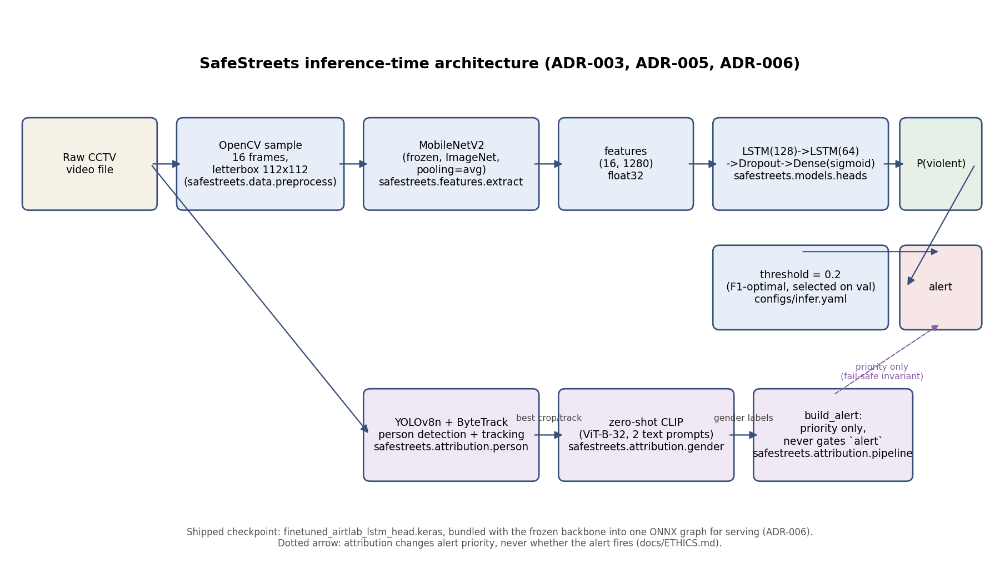

# SafeStreets

**Real-time violence detection for CCTV, built for a women's-safety context.**

SafeStreets scores short segments of video for physical violence and raises an alert when a
sustained rise in score crosses a calibrated threshold. It runs on CPU at roughly 18x real time,
so a single commodity machine can watch a live camera feed without a GPU.

[](https://github.com/kanadb004/SafeStreets-ViolenceDetection/actions/workflows/ci.yml)




---

## Overview

Most violence-detection research reports a single accuracy number on a single dataset. That number
tends to collapse in deployment, for two reasons this project treats as first-class problems:

1. **Dataset leakage.** Public violence datasets slice long source videos into many short clips.
   Split those clips at random and near-duplicate siblings land on both sides of the split,
   inflating every metric. SafeStreets splits on a derived `group_id` so all clips from one source
   video stay in the same partition, and asserts the partitions are disjoint on every run.
2. **Domain shift.** A model trained on organic street-fight footage does not transfer to staged,
   fixed-camera indoor footage. This repository measures that drop instead of hiding it, and ships
   a fine-tuned checkpoint that recovers it.

The system is a two-stage pipeline. A frozen ImageNet-pretrained **MobileNetV2** encodes each frame
into a 1280-dimensional embedding; a small **stacked LSTM** reads the 16-frame sequence and outputs
`P(violence)`. Serving bundles both stages into one ONNX graph.

An optional attribution stage runs person detection and tracking over an alerting clip and labels
each track, so an operator can triage which alerts to look at first. It is strictly advisory:
**attribution can never create or suppress an alert**, only annotate one that already fired.

---

## Results

Held-out test split, 325 clips from three datasets, operating threshold 0.2 selected on validation.
95% confidence intervals are from 1,000 bootstrap resamples. Every number below is generated from
a committed artifact under `artifacts/reports/`, and the full tables are in
[`docs/RESULTS.md`](docs/RESULTS.md).

| Metric | Value | 95% CI |
|---|---|---|
| ROC-AUC | 0.9450 | [0.9204, 0.9663] |
| PR-AUC | 0.9471 | [0.9201, 0.9704] |
| Accuracy | 0.8769 | [0.8400, 0.9138] |
| Precision | 0.8392 | [0.7905, 0.8923] |
| Recall | 0.9543 | [0.9191, 0.9828] |
| F1 | 0.8930 | [0.8595, 0.9260] |

Recall is deliberately favoured over precision: a missed assault costs more than a false alarm an
operator dismisses in two seconds.

### Cross-domain transfer

Evaluated zero-shot on AIRTLab, a staged fixed-camera dataset unlike anything in training, the
model scores **0.5259 ROC-AUC, which is close to chance.** Fine-tuning on AIRTLab with 5-fold
grouped cross-validation lifts it to **0.8976 +/- 0.0429**, at a measured cost of 0.0582 ROC-AUC on
the original RWF-2000 distribution. The fine-tuned checkpoint is the one that ships, and both
numbers are reported because the trade-off is real.

### Serving performance

Measured over 300 iterations on an Apple M2 (8 cores, CPU only, no GPU or CUDA):

| | |
|---|---|
| Latency per 16-frame window | **111 ms** p50, 134 ms p95, 168 ms p99 |
| Sustainable throughput | **59.5 sampled frames/s**, 18.6x real time |
| TensorFlow vs ONNX Runtime agreement | 5.24e-05 max absolute difference over 325 clips, identical ROC-AUC |

---

## How it works

| Stage | What happens |
|---|---|
| **Ingest** | OpenCV decodes video and subsamples to 3.2 fps, so a 16-frame window spans the same ~5 s of wall-clock time the model saw in training, regardless of source frame rate. |
| **Preprocess** | Frames resized to 112x112, normalised with MobileNetV2's `preprocess_input`, padded or uniformly sampled to exactly 16 frames. |
| **Augment** | Albumentations transforms drawn **once per clip** and replayed identically across its frames, so motion is never corrupted by per-frame jitter. |
| **Encode** | Frozen MobileNetV2 (`trainable=False`, global average pooling) maps each frame to 1280 features. Embeddings are precomputed and cached, making head training and hyperparameter search inexpensive. |
| **Classify** | A stacked LSTM with dropout reads the 16x1280 sequence and emits `P(violence)`. Trained with class-weighted binary cross-entropy. |
| **Score a stream** | A sliding window with stride 8 produces per-window scores, smoothed by an exponential moving average, with a hysteresis band around the threshold so a score oscillating at the boundary yields one alert rather than a burst. |
| **Attribute** | On an alerting clip, YOLOv8n plus ByteTrack recovers stable person tracks and a zero-shot CLIP classifier labels each one, for alert triage only. |

A from-scratch TimeDistributed CNN-LSTM is also implemented and trained as a comparison baseline;
see [`docs/RESULTS.md`](docs/RESULTS.md) for how it comes out against the frozen-encoder design, and
[`docs/decisions/`](docs/decisions/) for the reasoning behind the architecture, split strategy, and
deployment target.

---

## Installation

Requires Python 3.11. Apple silicon uses the `tensorflow-macos` and `tensorflow-metal` wheels
pinned in the `ml` extra; on Linux, install plain `tensorflow==2.16.2` instead.

```bash
git clone https://github.com/kanadb004/SafeStreets-ViolenceDetection.git
cd SafeStreets-ViolenceDetection

python -m venv .venv && source .venv/bin/activate   # or conda create -n safestreets python=3.11
pip install -e ".[dev,ml]"
```

Verify the install:

```bash
make verify-all      # ruff lint + the full test suite
```

---

## Usage

### Web application

```bash
python -c "from safestreets.web import create_app; create_app().run(port=5000)"
```

Open `http://127.0.0.1:5000`, upload a clip, and get a verdict, a clip-level score, and a
per-window timeline showing where the score crossed the alert band. `GET /healthz` reports the
loaded model version and operating threshold.

### JSON API

```bash
curl -F "video=@clip.mp4" http://127.0.0.1:5000/api/analyse
```

Abridged real response (`windows` holds one entry per sliding window):

```json
{
  "clip_score": 0.8565809726715088,
  "verdict": "violent",
  "threshold": 0.2,
  "enter_threshold": 0.25,
  "leave_threshold": 0.15000000000000002,
  "alert_events": 1,
  "n_frames_decoded": 30,
  "fps": 30.0,
  "frame_step": 9,
  "padded": false,
  "short_video": true,
  "windows": [
    {
      "index": 0,
      "start_frame": 0,
      "end_frame": 29,
      "raw_score": 0.8565809726715088,
      "smoothed_score": 0.8565809726715088,
      "alert_active": true,
      "alert_started": true,
      "start_s": 0.0,
      "end_s": 0.967
    }
  ],
  "model_version": "finetuned_airtlab-73ebf22e032d"
}
```

`enter_threshold` and `leave_threshold` are the hysteresis band; `alert_events` counts rising
edges of the smoothed alert latch. Errors return `{"error": "..."}` with status 400 (no file),
413 (too large), or 415 (unsupported extension or undecodable video).

### Python

```python
from safestreets.inference.engine import InferenceEngine

engine = InferenceEngine()                 # bundled ONNX graph, paths from configs/
print(engine.model_version)                # "finetuned_airtlab-73ebf22e032d"

score = engine.score_clip("clip.mp4")      # clip-level P(violence)
print(score, engine.verdict(score))        # 0.857 "violent"

result = engine.analyse_video("clip.mp4")  # score plus the full window timeline
for w in result["windows"]:
    print(w["index"], w["smoothed_score"], w["alert_active"])
```

The engine refuses to load an ONNX graph whose sidecar contract disagrees with the active
preprocessing config, so a model can never be served under settings it was not exported for.

`InferenceEngine` runs entirely on ONNX Runtime and imports no TensorFlow, so serving does not need
the training stack installed.

### Command line

Each stage is a script with `--help`:

```bash
python scripts/fetch_data.py       --dataset all     # download sources, build manifests and splits
python scripts/build_cache.py                        # decode to a fixed-size clip cache
python scripts/extract_features.py --dataset all     # precompute frozen MobileNetV2 embeddings
python scripts/train.py            --arch lstm_head  # train the classifier head
python scripts/evaluate.py                           # metrics, figures, cross-dataset matrix
python scripts/tune.py             --trials 30       # Optuna hyperparameter search
python scripts/finetune.py                           # grouped k-fold fine-tune on AIRTLab
python scripts/export_onnx.py                        # bundle encoder + head into one ONNX graph
```

All tunables live in `configs/*.yaml`, including the random seed (1265), so runs are
reproducible without passing flags. Dataset download uses the
[Kaggle CLI](https://github.com/Kaggle/kaggle-api) and needs API credentials configured first.

---

## Notebooks

Six notebooks walk through the pipeline end to end. Each imports from the `safestreets` package
rather than reimplementing it, and executes in under a minute with outputs committed.

| Notebook | Contents |
|---|---|
| [`01_data_and_preprocessing`](notebooks/01_data_and_preprocessing.ipynb) | Sources and licences, group-aware splitting, the leakage assertion, the clip cache |
| [`02_augmentation`](notebooks/02_augmentation.ipynb) | Clip-consistent augmentation with a live proof that frames stay in sync, plus throughput |
| [`03_model_and_training`](notebooks/03_model_and_training.ipynb) | Both architectures, the frozen-encoder measurements, training curves, TensorBoard histograms |
| [`04_evaluation`](notebooks/04_evaluation.ipynb) | Metrics with bootstrap CIs, ROC/PR/confusion, threshold sweep, cross-dataset matrix |
| [`05_hpo_and_finetune`](notebooks/05_hpo_and_finetune.ipynb) | The Optuna study, checkpoint selection, AIRTLab fine-tuning and the forgetting check |
| [`06_inference_and_demo`](notebooks/06_inference_and_demo.ipynb) | Attribution and its fail-safe invariant, ONNX parity and latency, streaming scoring, the web app |

---

## Datasets

| Dataset | Clips | Role | Licence |
|---|---|---|---|
| [RWF-2000](https://github.com/mchengny/RWF2000-Video-Database-for-Violence-Detection) | 2,000 | Primary training distribution, organic surveillance footage | Research and education use |
| [RLVS](https://www.kaggle.com/datasets/mohamedmustafa/real-life-violence-situations-dataset) | 1,951 | Primary training and test distribution | CC0 / public domain |
| [AIRTLab](https://github.com/airtlab/A-Dataset-for-Automatic-Violence-Detection-in-Videos) | 350 | Domain-shift evaluation and fine-tuning target | Research and education use |
| UCF-Crime (subset) | 35 | Cross-domain spot check | Research use |

4,336 clips in total across 3,873 source-video groups. Datasets are **not** redistributed here;
`scripts/fetch_data.py` retrieves them from their original hosts. Full provenance, access methods,
citations, and label balance are in [`docs/DATASETS.md`](docs/DATASETS.md).

Frame-level temporal localisation on untrimmed video is out of scope: the dataset that would
support it (XD-Violence) is 38.3 GB, beyond this project's storage budget.

---

## Project structure

```
safestreets/          # the library every script and notebook calls into
  data/               # download, manifests, group-aware splits, preprocessing, augmentation
  features/           # frozen-encoder embedding extraction and caching
  models/             # architectures and the config-driven model factory
  training/           # training loop, callbacks, losses, HPO, fine-tuning
  evaluation/         # metrics with bootstrap CIs, cross-dataset matrix, report generation
  attribution/        # person detection, tracking, track labelling, fail-safe alert assembly
  inference/          # ONNX export, inference engine, sliding-window stream scorer
  web/                # Flask application, JSON API, upload handling
scripts/              # one command per pipeline stage
configs/              # all tunables as YAML
notebooks/            # the six walkthrough notebooks
tests/                # pytest suite, 143 tests
docs/                 # results, model card, ethics, datasets, reproduction, design decisions
```

---

## Development

```bash
make lint             # ruff
make test             # fast tests only, skips those needing downloaded datasets
make verify-all       # lint + the full suite
make notebooks        # re-execute every notebook in place
```

CI runs lint and the dataset-independent tests on every push and pull request.

### What is committed

Committed, so every published number traces to a file in this repository: all evaluation, parity,
latency and training-history JSON under `artifacts/reports/`, the figures, the model summaries, and
the Optuna study database.

Not committed, because they are large and reproducible: model checkpoints (29 MB), the exported
ONNX graph (11 MB), third-party detector weights, and the datasets themselves (7.4 GB).
[`docs/REPRODUCE.md`](docs/REPRODUCE.md) gives the command sequence that rebuilds all of it from a
clean clone, with pinned versions and fixed seeds.

---

## Responsible use

This is a research prototype and a screening aid. It is not a decision-making system, and it should
not be used to make consequential judgements about people without human review.

- **The fail-safe invariant.** An alert is computed from the violence score alone, before any
  attribution output is read. Person and gender attribution can only annotate an alert's priority;
  they cannot gate it. This is enforced by the structure of `safestreets/attribution/pipeline.py`
  and covered by a test that forces the adversarial case.
- **The attribution stage is unvalidated.** Its gender classifier is zero-shot, fit to no labelled
  data, and no dataset here carries person-level gender ground truth, so **its accuracy is
  unmeasured, not measured and good.** Treat its output as a weak triage hint only.
- **Known limitations** are documented rather than minimised: cross-domain performance drops
  sharply without fine-tuning, the shipped fine-tune costs accuracy on the original distribution,
  the operating threshold was calibrated for the pre-fine-tune checkpoint, and latency figures come
  from one machine under its own load.

Full discussion in [`docs/ETHICS.md`](docs/ETHICS.md) and
[`docs/MODEL_CARD.md`](docs/MODEL_CARD.md), which covers intended use, out-of-scope use, training
data, and every limitation above.

---

## Documentation

| Document | Contents |
|---|---|
| [`docs/RESULTS.md`](docs/RESULTS.md) | Every metric, generated from committed artifacts |
| [`docs/MODEL_CARD.md`](docs/MODEL_CARD.md) | Intended use, training data, metrics, limitations |
| [`docs/ETHICS.md`](docs/ETHICS.md) | Attribution risks, the fail-safe design, what is unmeasured |
| [`docs/DATASETS.md`](docs/DATASETS.md) | Provenance, licences, citations, label balance |
| [`docs/REPRODUCE.md`](docs/REPRODUCE.md) | Full rebuild from a clean clone |
| [`docs/decisions/`](docs/decisions/) | Design decisions and the measurements behind them |

---

## Citation

If you use this code, please also cite the dataset authors, whose work this depends on. Citations
for all four datasets are in [`docs/DATASETS.md`](docs/DATASETS.md).

Built with [TensorFlow](https://www.tensorflow.org/), [Keras](https://keras.io/),
[ONNX Runtime](https://onnxruntime.ai/), [Albumentations](https://albumentations.ai/),
[Optuna](https://optuna.org/), [MLflow](https://mlflow.org/),
[Ultralytics YOLO](https://docs.ultralytics.com/), and [OpenCLIP](https://github.com/mlfoundations/open_clip).

## Licence

No licence has been declared for this repository yet, so no usage rights are granted by default.
The datasets it consumes are released for research and education use under their own terms, which
this project does not relicense or redistribute.
